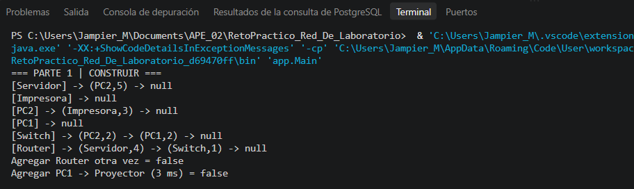
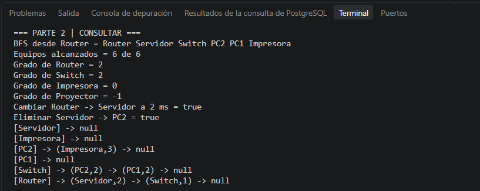
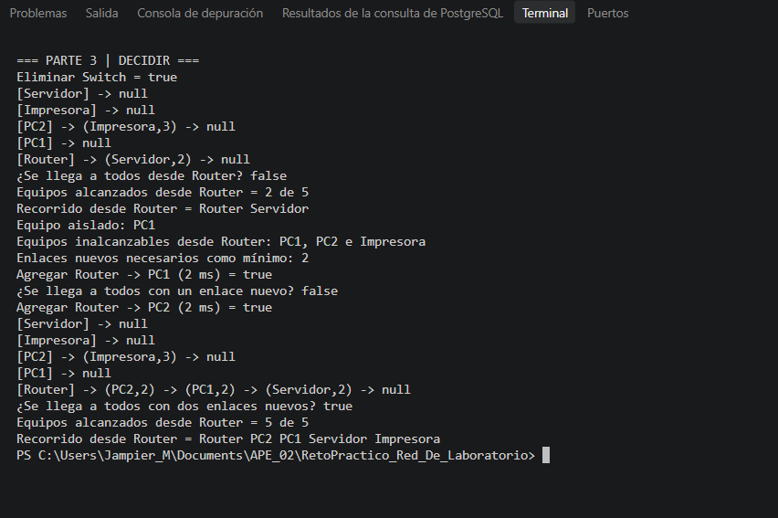
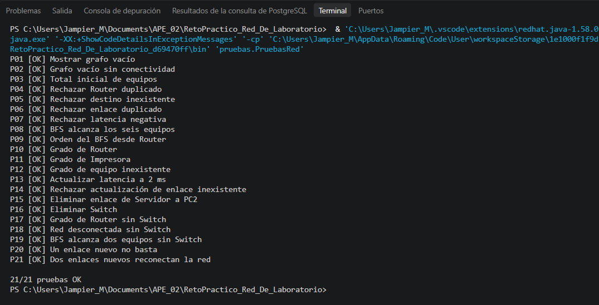

# Reto práctico: "La red del laboratorio"

Estructura de Datos · 3.er semestre de Software · FISEI-UTA · Docente: Ing. José Rubén Caiza
Reto propuesto por el Grupo 5 en su exposición de multilistas y grafos dinámicos (Unidad 4, 16/11/2026).

La red de un laboratorio se representa como un grafo dirigido y ponderado construido con nodos enlazados propios: sin `HashMap`, sin `ArrayList` y sin librerías de grafos. Sobre ese grafo se construye la red, se consulta y se decide cómo reconectarla cuando un equipo se daña.

## Contenido

1. [Enunciado del reto](#enunciado-del-reto)
2. [Integrantes](#integrantes)
3. [Origen del código base](#origen-del-código-base)
4. [Cómo se representa la red](#cómo-se-representa-la-red)
5. [Estructura del proyecto](#estructura-del-proyecto)
6. [Operaciones del grafo y su costo](#operaciones-del-grafo-y-su-costo)
7. [Compilación y ejecución](#compilación-y-ejecución)
8. [Salida del programa](#salida-del-programa)
9. [Pruebas](#pruebas)
10. [Capturas de la consola](#capturas-de-la-consola)
11. [Código de grado(id)](#código-de-gradoid)
12. [Respuestas de la parte 3](#respuestas-de-la-parte-3)

## Enunciado del reto

Representar la red del laboratorio como un **grafo dirigido con multilistas**, usando solo las clases `Vertice`, `Arista` y `Grafo`. No se puede usar `HashMap`, `ArrayList` ni librerías de grafos.

**Equipos:** Router, Switch, PC1, PC2, Impresora, Servidor.

**Enlaces (latencia en ms):**

| Origen | Destino | Latencia |
|---|---|---|
| Router | Switch | 1 |
| Router | Servidor | 4 |
| Switch | PC1 | 2 |
| Switch | PC2 | 2 |
| PC2 | Impresora | 3 |
| Servidor | PC2 | 5 |

**Lo que se pide:**

1. **Construir.** Insertar los equipos y los enlaces y llamar a `mostrar()`. Probar que agregar "Router" otra vez y agregar PC1 → Proyector (3) devuelven `false`.
2. **Consultar.** Ejecutar `bfs("Router")`. Programar `grado(id)`, que devuelve -1 si el equipo no existe. Cambiar la latencia de Router → Servidor a 2 y eliminar Servidor → PC2.
3. **Decidir.** El Switch se dañó: eliminarlo y verificar con `esConexo("Router")`. ¿Qué equipos quedaron aislados? ¿Cuántos enlaces nuevos hacen falta, como mínimo, para reconectarlos? Agregarlos y comprobar.

**Entrega:** capturas de la consola, el código de `grado(id)` y las respuestas de la parte 3, subido a GitHub.

## Integrantes

| Integrante | Rol | Aporte |
|---|---|---|
| Cunalata Mendoza Damian Alexander | Líder técnico e integración | Documentación, estructura del repositorio, respuestas de la parte 3 e integración de las ramas |
| Tisalema Guashco Darwin Joel | Desarrollo y pruebas | Paquete `modelo` (`Vertice`, `Arista`) y las pruebas `PruebasRed` |
| Silva Camuendo Luis Alexander | Desarrollo | `Grafo`: inserción de equipos y enlaces, `mostrar` y `grado(id)` |
| Tacuri Santillan Mónica Sara | Desarrollo | `Grafo`: actualización, eliminación, recorrido BFS y `esConexo` |
| Camacho Monta Josue Jampier | Desarrollo y documentación | Programa `Main` con las tres partes del reto y capturas de la consola |

**Chalco Tasna Kenneth Mateo** no participó en este reto porque no asistió a clases; no tiene clases ni tareas a su cargo y el trabajo se repartió entre los cinco integrantes restantes.

El detalle de lo que hizo cada integrante, con sus archivos, métodos y commits, está en [docs/tareas/](docs/tareas/).

## Origen del código base

El reto se resuelve sobre el modelo que presentó el Grupo 5 en su repositorio [Grupo5-Multilistas-Grafos-Dinamicos](https://github.com/gamboarommel580-rgb/Grupo5-Multilistas-Grafos-Dinamicos): una lista de vértices con nodos propios y, colgada de cada vértice, su lista de aristas. Las clases `Vertice`, `Arista` y `Grafo` de este repositorio son una adaptación de ese código, reducida a las operaciones que usa este reto. El programa `Main` de la red del laboratorio, las pruebas `PruebasRed` y esta documentación son de este equipo.

## Cómo se representa la red

Cada **equipo** es un `Vertice` y cada **enlace** es una `Arista` con su latencia como peso. El grafo guarda un solo puntero, `cabeza`, al primer vértice.

- `Vertice`: nombre del equipo, puntero a su primera arista y puntero al siguiente vértice.
- `Arista`: vértice destino, latencia y puntero a la siguiente arista del mismo origen.

Los vértices y las aristas se insertan **al inicio** de su lista. Por eso `mostrar()` imprime los equipos en orden inverso al de inserción y el BFS visita primero el último enlace agregado. Así queda la red del reto en memoria:

```
cabeza
  |
[Servidor]  -> (PC2,5) -> null
  |
[Impresora] -> null
  |
[PC2]       -> (Impresora,3) -> null
  |
[PC1]       -> null
  |
[Switch]    -> (PC2,2) -> (PC1,2) -> null
  |
[Router]    -> (Servidor,4) -> (Switch,1) -> null
  |
 null
```

El grafo es **dirigido**: Router → Switch no implica Switch → Router. Por eso `esConexo("Router")` responde si desde el Router se alcanzan todos los equipos siguiendo el sentido de los enlaces; no es conexidad fuerte.

Para cumplir la regla de no usar colecciones de Java, el BFS no usa `Queue` ni `HashSet`: la cola se enlaza con un puntero `sigCola` dentro de cada `Vertice` y los visitados son una marca booleana en el mismo nodo.

## Estructura del proyecto

```
src/
  modelo/   Vertice.java, Arista.java     nodos de las listas
  negocio/  Grafo.java                    operaciones del grafo
  app/      Main.java                     las tres partes del reto
  pruebas/  PruebasRed.java               21 pruebas sin JUnit
docs/
  capturas/                               capturas de la consola
  tareas/                                 qué hizo cada integrante
  Pruebas.md                              salida completa de las pruebas
  Respuestas_Parte3.md                    respuestas de la parte 3 con su justificación
```

Las capas van en un solo sentido: `app → negocio → modelo`. `Main` y `PruebasRed` solo llaman a métodos públicos de `Grafo`; nunca tocan un `Vertice` o una `Arista` directamente.

## Operaciones del grafo y su costo

V = número de equipos, A = número de enlaces, grado = enlaces que salen de un equipo.

| Método | Qué hace | Devuelve | Costo |
|---|---|---|---|
| `agregarVertice(id)` | Inserta un equipo al inicio de la lista | `false` si es null, vacío o repetido | O(V) |
| `agregarArista(o, d, peso)` | Inserta el enlace o → d al inicio de la lista de o | `false` si falta un equipo, es un lazo, el peso es negativo o ya existe | O(V + grado) |
| `mostrar()` | Lista de adyacencia, una línea por equipo | `String` | O(V + A) |
| `totalVertices()` | Cuenta los equipos | `int` | O(V) |
| `grado(id)` | Cuenta los enlaces que salen del equipo | **-1 si el equipo no existe** | O(V + grado) |
| `actualizarPeso(o, d, peso)` | Cambia la latencia de un enlace existente | `false` si el enlace no existe | O(V + grado) |
| `eliminarArista(o, d)` | Quita un enlace con un puntero previo | `false` si no existe | O(V + grado) |
| `eliminarVertice(id)` | Quita los enlaces que llegan al equipo y luego lo desenlaza | `false` si no existe | O(V + A) |
| `recorridoBfs(inicio)` | Recorrido en anchura | Orden de visita como texto | O(V + A) |
| `bfs(inicio)` | Recorrido en anchura | Cuántos equipos alcanza | O(V + A) |
| `esConexo(inicio)` | Compara lo alcanzado con el total | `true` si se llega a todos | O(V + A) |

`eliminarVertice` es la operación más cara: antes de desenlazar el equipo hay que revisar la lista de aristas de todos los demás para quitar los enlaces que llegan a él. Si no se hiciera, quedaría un enlace apuntando a un equipo que ya no existe.

## Compilación y ejecución

Requiere JDK 11 o superior. Desde la carpeta del proyecto, en PowerShell:

```powershell
javac -encoding UTF-8 -d out (Get-ChildItem -Recurse -Filter *.java src).FullName
java -cp out app.Main
java -cp out pruebas.PruebasRed
```

En Git Bash o Linux, la primera línea cambia por:

```bash
javac -encoding UTF-8 -d out $(find src -name "*.java")
```

`app.Main` ejecuta las tres partes del reto en orden. `pruebas.PruebasRed` termina con `21/21 pruebas OK`.

## Salida del programa

```
=== 1. CONSTRUIR ===
Servidor -> PC2(5)
Impresora ->
PC2 -> Impresora(3)
PC1 ->
Switch -> PC2(2) PC1(2)
Router -> Servidor(4) Switch(1)
Agregar "Router" otra vez: false
Agregar PC1 -> Proyector (3): false

=== 2. CONSULTAR ===
bfs("Router"): Router Servidor Switch PC2 PC1 Impresora (alcanza 6 de 6)
grado(Router) = 2
grado(Switch) = 2
grado(Impresora) = 0
grado(Proyector) = -1  (no existe)
Latencia Router -> Servidor a 2: true
Eliminar Servidor -> PC2: true
Servidor ->
Impresora ->
PC2 -> Impresora(3)
PC1 ->
Switch -> PC2(2) PC1(2)
Router -> Servidor(2) Switch(1)

=== 3. DECIDIR ===
Eliminar Switch: true
Servidor ->
Impresora ->
PC2 -> Impresora(3)
PC1 ->
Router -> Servidor(2)
esConexo("Router"): false (alcanza 2 de 5: Router Servidor)
Aislados: PC1, PC2 e Impresora. Enlaces nuevos minimos: 2
Agregar Router -> PC1 (2): true
Agregar Router -> PC2 (2): true
Servidor ->
Impresora ->
PC2 -> Impresora(3)
PC1 ->
Router -> PC2(2) PC1(2) Servidor(2)
esConexo("Router"): true (alcanza 5 de 5: Router PC2 PC1 Servidor Impresora)
```

Los equipos salen en orden inverso al de inserción porque el grafo inserta al inicio de la lista.

## Pruebas

Código en `src/pruebas/PruebasRed.java` · Salida completa en [docs/Pruebas.md](docs/Pruebas.md)

Las pruebas no usan JUnit: cada caso llama a un método de `Grafo`, compara con el valor esperado e imprime `OK` o `FALLA`. Al final se imprime el total: **21/21 pruebas OK**.

| N.º | Parte | Caso | Esperado | Resultado |
|---|---|---|---|---|
| P01 | Límite | `mostrar()` con el grafo vacío | `(grafo vacio)` | OK |
| P02 | Límite | `esConexo("Router")` con el grafo vacío | `false` | OK |
| P03 | 1 | Total de equipos tras construir la red | 6 | OK |
| P04 | 1 | Agregar "Router" otra vez | `false` | OK |
| P05 | 1 | Agregar PC1 → Proyector (3) | `false` | OK |
| P06 | 1 | Agregar otra vez Router → Switch | `false` | OK |
| P07 | 1 | Agregar un enlace con latencia negativa | `false` | OK |
| P08 | 2 | `bfs("Router")` | 6 | OK |
| P09 | 2 | Orden del BFS desde Router | `Router Servidor Switch PC2 PC1 Impresora` | OK |
| P10 | 2 | `grado("Router")` | 2 | OK |
| P11 | 2 | `grado("Impresora")` | 0 | OK |
| P12 | 2 | `grado("Proyector")` | -1 | OK |
| P13 | 2 | Cambiar Router → Servidor a 2 | `true` | OK |
| P14 | 2 | Cambiar la latencia de un enlace que no existe | `false` | OK |
| P15 | 2 | Eliminar Servidor → PC2 | `true` y `grado("Servidor")` = 0 | OK |
| P16 | 3 | Eliminar el Switch | `true` y quedan 5 equipos | OK |
| P17 | 3 | `grado("Router")` sin el Switch | 1 | OK |
| P18 | 3 | `esConexo("Router")` sin el Switch | `false` | OK |
| P19 | 3 | `bfs("Router")` sin el Switch | 2 | OK |
| P20 | 3 | `esConexo("Router")` con un solo enlace nuevo | `false` | OK |
| P21 | 3 | `esConexo("Router")` con dos enlaces nuevos | `true` | OK |

## Capturas de la consola

### Parte 1 · Construir



### Parte 2 · Consultar



### Parte 3 · Decidir



### Pruebas



## Código de grado(id)

```java
/** Grado de salida: cuantos enlaces salen del equipo. -1 si el equipo no existe. O(V + grado) */
public int grado(String id) {
    Vertice v = buscar(id);
    if (v == null) {
        return -1;
    }
    int n = 0;
    for (Arista a = v.getAristas(); a != null; a = a.getSig()) {
        n++;
    }
    return n;
}
```

`grado(id)` primero busca el equipo en la lista de vértices. Si no lo encuentra devuelve -1, que no puede confundirse con un grado real porque un grado nunca es negativo: un equipo sin enlaces de salida, como la Impresora, tiene grado 0. Si lo encuentra, recorre su lista de aristas y cuenta los nodos. Es el grado de salida.

| Llamada | Resultado |
|---|---|
| `grado("Router")` | 2 |
| `grado("Switch")` | 2 |
| `grado("Impresora")` | 0 |
| `grado("Proyector")` | -1 |

## Respuestas de la parte 3

Justificación completa en [docs/Respuestas_Parte3.md](docs/Respuestas_Parte3.md).

| Pregunta | Respuesta |
|---|---|
| `esConexo("Router")` tras eliminar el Switch | `false`: desde el Router solo se alcanzan 2 de 5 equipos (Router y Servidor) |
| Equipos aislados | PC1, PC2 e Impresora |
| Enlaces nuevos mínimos | 2: PC1 y PC2 quedaron sin enlaces de entrada y cada uno necesita uno; la Impresora se recupera por PC2 → Impresora |
| Enlaces agregados | Router → PC1 (2) y Router → PC2 (2) |
| Comprobación | `esConexo("Router")` devuelve `true`: alcanza 5 de 5 |
