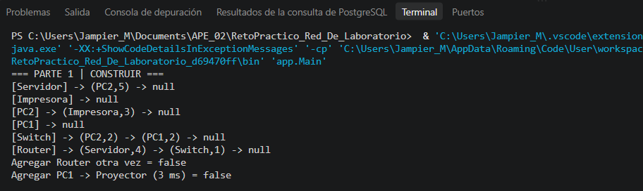
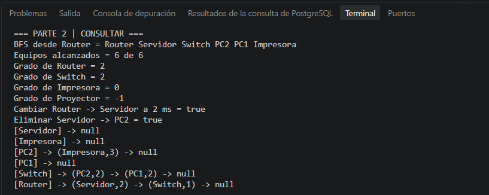
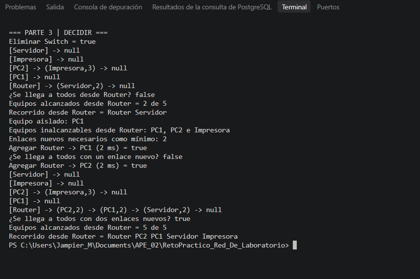
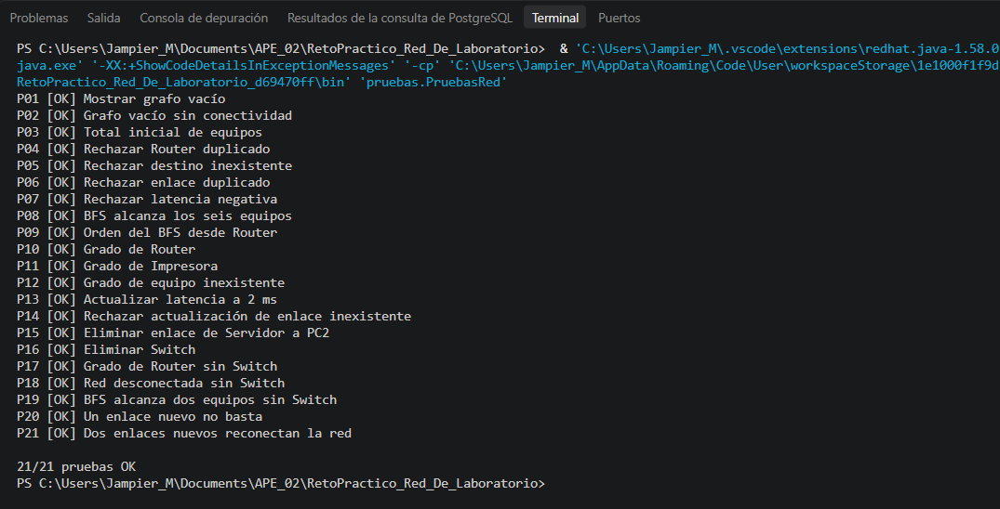

# Capturas de la ejecución

Evidencias del reto **La red del laboratorio**.

## Parte 1. Construir

Se muestra la red inicial con seis equipos y sus enlaces. Agregar el Router por segunda vez y crear el enlace de PC1 a Proyector devuelven `false`.

## Parte 2. Consultar

El recorrido BFS desde el Router alcanza los seis equipos. Se consultan los grados de salida, se cambia a 2 ms la latencia del enlace de Router a Servidor y se elimina el enlace de Servidor a PC2.

## Parte 3. Decidir

Tras eliminar el Switch, el Router solo alcanza a 2 de los 5 equipos restantes. Con el enlace de Router a PC1 todavía quedan equipos fuera de alcance. Al agregar también el enlace de Router a PC2, se vuelve a alcanzar a los cinco equipos.

## Pruebas de la red

La ejecución de `PruebasRed.java` verifica 21 casos de inserción, consulta, modificación, eliminación y conectividad.

